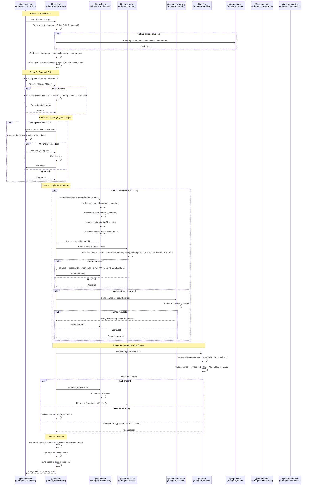

# OpenCode OpenSpec Multi-Agent
<!-- LANG-SELECTOR START -->

<div align="center">

<strong>🌐 Language / Idioma:</strong>

- 🇺🇸 <a href="#english">English</a> — default
- 🇨🇱 <a href="#spanish">Español</a>

</div>

<!-- LANG-SELECTOR END -->


<!-- ENGLISH -->
<a id="english"></a>

## Agents

```mermaid
flowchart TD
    User["👤 User"] -->|"Describe your change"| Architect["@architect<br/>Orchestrator"]

    Architect -->|"Scan repo"| Scout["@repo-scout<br/>Read-only"]
    Scout -->|"Stack & conventions"| Architect

    Architect -->|"Build spec"| Spec["📋 OpenSpec spec"]
    User -->|"Approve / Revise"| Architect

    Architect -->|"UX review"| UXDes["@ux-designer<br/>Wireframes + tokens"]
    UXDes --|"Fix needed"| Spec
    UXDes -->|"Approved"| Architect

    Architect -->|"Implement"| Developer["@developer<br/>Writes code"]
    Developer -->|"Done"| Architect

    Architect -->|"Code review"| CodeRev["@code-reviewer<br/>Clean code + tests"]
    CodeRev -.->|Fix needed| Developer
    CodeRev -->|"Approved"| TestEng["@test-engineer<br/>Unit + integration tests"]
    TestEng -->|"Approved"| SecRev["@security-reviewer<br/>12 security criteria"]

    SecRev -.->|Fix needed| Developer
    SecRev -->|"Approved"| Verifier["@verifier<br/>Independent verify"]

    Verifier -.->|FAIL| Developer
    Verifier -->|"Clean"| Architect

    Architect -->|"Archive"| Done["✅ Change archived"]
```

| Agent | Role |
|---|---|
| **@architect** | Orchestrator: drives the loop, creates specs, delegates, archives. Never writes code. |
| **@developer** | Implements the spec and runs project checks. |
| **@code-reviewer** | Reviews code against clean-code criteria (12 rules). |
| **@security-reviewer** | Reviews code against security criteria (12 rules). |
| **@verifier** | Independent verification: runs tests, maps spec scenarios to evidence. |
| **@repo-scout** | Read-only scan: stack, conventions, lint/test commands. |
| **@ux-designer** | UX: generates wireframes (ASCII), specifies design tokens, reviews UX in specs. Inserted before @developer for UI changes. |
| **@test-engineer** | Writes unit and integration tests from OpenSpec scenarios. Covers edge cases, mocks, fixtures. |

A multi-agent orchestrated development workflow that uses [OpenSpec](https://openspec.dev) as the source of truth for product and architecture requirements. Agents collaborate in a structured loop — from specification through implementation to review — keeping every change grounded in a written spec before the implementation starts.

<details>
<summary><strong>🇨🇱 Versión en Español</strong> — click para expandir</summary>

<!-- SPANISH -->
<a id="spanish"></a>

## How it works

```
User describes change -> @architect builds OpenSpec spec -> User approves
                                                         |
                                                         v
                                              @developer writes code
                                                         |
                                              +----------+----------+
                                              |                     |
                                              v                     v
                                       @code-reviewer     @security-reviewer
                                       (12 clean code)   (12 security rules)
                                              |                     |
                                              +----------+----------+
                                                         |
                                                         v
                                                  @verifier runs tests
                                                  maps spec -> evidence
                                                         |
                                              +----------+----------+
                                              |                     |
                                         PASS ok                  FAIL no
                                              |                     |
                                              v                     v
                                        @architect             @developer fixes
                                        archives spec          loop restarts
```

**Delegación a subagentes:**

El `@architect` delega tareas a subagentes usando skills de OpenSpec (por ej., `openspec-apply-change`, `openspec-verify-change`). Cada subagente opera en una **sesión independiente** sin historial de conversación — empieza desde cero. El `@architect` debe pasar todo el contexto necesario explícitamente: los artefactos del change de OpenSpec (proposal, design, tasks, specs), las convenciones de `AGENTS.md` del proyecto, y cualquier feedback de revisión.

Los subagentes pueden pedir correcciones al `@architect`, quien las reenvía al `@developer` para que las arregle. Este modelo de delegación asegura que cada agente trabaje con un brief completo y autocontenido — sin suposiciones, sin memoria compartida, sin vacíos.

**En 6 pasos:**

1. **Spec** - @architect trabaja con vos para escribir un spec en OpenSpec: qué se va a hacer, por qué, y cómo se mide que está bien. Todo queda en archivos (proposal.md, design.md, tasks.md, spec.md).

2. **UX Design** - Si el cambio incluye UI/UX, @ux-designer genera wireframes (ASCII), especifica tokens de diseño (colores, tipografía, spacing) y revisa que el spec tenga requisitos de UX completos.

3. **Implementación** - @developer escribe el código siguiendo el spec. No adivina: cada task del spec se traduce en código.

4. **Revisión** - Dos agentes revisan en paralelo:
   - @code-reviewer: verifica código limpio (12 reglas objetivas: nombres, tamaño de funciones, SRP, DRY, etc.)
   - @security-reviewer: verifica seguridad (12 reglas objetivas: inyección SQL, XSS, auth, tokens, etc.)
   - Ambos pueden pedir correcciones. El loop repite hasta que ambos aprueban.

5. **Verificación independiente** - @verifier es el último filtro. No confía en las palabras de nadie: ejecuta los comandos reales del proyecto (npm test, openspec validate, etc.) y mapea cada scenario del spec a evidencia observable. Devuelve un reporte por escenario:
   - **PASS** - el comportamiento existe y está confirmado
   - **FAIL** - algo no coincide, vuelve al developer
   - **UNVERIFIABLE** - no se puede automatizar, se documenta y justifica

6. **Archive** - Solo @architect puede cerrar un spec. Verifica que todo pase (openspec validate --strict, sin FAILs, diff en scope) y archiva el cambio, sincronizando los requisitos al spec principal.

**Reglas clave:**
- @architect **nunca escribe código** — solo orquesta, especifica y archiva
- @developer **nunca aprueba su propio trabajo** — siempre pasa por revisión
- @ux-designer **solo actúa en cambios UI** — genera wireframes y tokens de diseño
- @verifier **nunca asume** — ejecuta comandos reales para confirmar
- Todo queda registrado: specs, diseños, diffs, reportes de revisión y verificación

</details>


## Requirements

The workflow depends on the OpenSpec CLI and its generated skills:

| Component | Minimum version | Why |
|---|---|---|
| Node.js | `>= 20.19.0` | Required by the OpenSpec CLI, and runs the setup scripts. |
| [`@fission-ai/openspec`](https://www.npmjs.com/package/@fission-ai/openspec) | `>= 1.14.0` | Installs the `openspec-*` skills the agents load. Older versions use different skill names and the workflow breaks. |
| [`openspec-mcp`](https://www.npmjs.com/package/openspec-mcp) | any | MCP server exposing OpenSpec operations to the agents. |
| [Context7](https://context7.com) | any | Up-to-date library/framework docs. A `context7` entry under `mcp.servers`, or the `ctx7` CLI. |
| [OpenCode](https://opencode.ai) | V2 | Agent definitions use the V2 `mode` / `permissions` frontmatter, and config uses `mcp.servers`. |

These are declared in [`package.json`](package.json) and enforced by `scripts/check.mjs`, so a fresh clone cannot silently run against an incompatible OpenSpec or a dead Context7 entry.

## Workflow

```
User ──► @architect
             │
             ├─ preflight: verify openspec CLI/skills (>= 1.14.0) and context7
             │
             ├─ calls @repo-scout (first run or on repo change)
             │
             ├─ guides user through openspec-explore / openspec-propose
             │   to build the OpenSpec specification
             │
             │  [on explicit user approval]
             │
             ├─► @developer  (openspec-apply-change)
             │       │
             │       └─► reports completion
             │
             ├─► @code-reviewer
             │       │
             │       ├─ change requests ──► @developer (loop)
             │       │
             │       └─ approved ──► @security-reviewer
             │
             ├─► @security-reviewer
             │       │
             │       ├─ change requests ──► @developer (loop)
             │       │
             │       └─ approved ──► @architect
             │
             └─► @architect closes the spec (openspec-archive-change)
```

1. **Preflight** — `@architect` verifies the OpenSpec CLI and skills are present and at the required version, and stops with install instructions otherwise.
2. **Discovery** — `@architect` inspects the repo (via `@repo-scout` if needed) and collaborates with the user to define an OpenSpec specification using the `openspec-explore` and `openspec-propose` skills.
3. **Approval gate** — implementation only starts after the user explicitly approves.
4. **Implementation** — `@developer` applies the spec (`openspec-apply-change`), follows existing repo conventions, adds tests, and validates with linters/type-checkers before reporting back.
5. **Code review** — `@code-reviewer` reads the OpenSpec change, runs `git diff`, checks correctness, security, and test coverage, and either requests changes or approves.
6. **Security review** — `@security-reviewer` evaluates code against 12 objective security criteria. CRITICAL findings block progression.
7. **Loop** — steps 4–6 repeat until `@code-reviewer` and `@security-reviewer` both approve and `@architect` is satisfied.
8. **Close** — `@architect` archives the change with `openspec-archive-change`, syncing the requirements into `openspec/specs/`. Only `@architect` closes a spec.

`@architect` may additionally dispatch `@diff-summarizer` at any point to get a terse, risk-flagged overview of a large diff before diving deeper.

## Agent Architecture



### Agents

| Agent | Mode | Role | When invoked |
|---|---|---|---|
| [@architect](opencode/agents/architect.md) | primary | Orchestrator: drives the full loop, creates specs, delegates, evaluates reviews, archives. Never writes code. Only agent that can close a spec. | Always (first contact) |
| [@developer](opencode/agents/developer.md) | subagent | Implements the spec, runs checks, writes documentation when visible. Applies clean-code-criteria. | After user approval |
| [@code-reviewer](opencode/agents/code-reviewer.md) | subagent | Reviews against the OpenSpec change: correctness, security, simplicity, clean-code (12 criteria), tests, docs accuracy. Tags with CRITICAL/WARNING/SUGGESTION. | After developer reports completion |
| [@security-reviewer](opencode/agents/security-reviewer.md) | subagent | Evaluates code against 12 objective security criteria. Tags findings CRITICAL/WARNING/SUGGESTION. Mandatory gate before `@verifier`. | After code-reviewer approves |
| [@verifier](opencode/agents/verifier.md) | subagent | Independent verification: executes project commands, maps spec scenarios to observable evidence. No-write policy. | After reviewer approves, before archive |
| [@test-engineer](opencode/agents/test-engineer.md) | subagent | Writes unit and integration tests from OpenSpec scenarios. Covers edge cases, mocks, fixtures. | On-demand (test coverage) |
| [@ux-designer](opencode/agents/ux-designer.md) | subagent | UX: generates ASCII wireframes, specifies design tokens, reviews UX in specs. Inserted before @developer for UI changes. | Before implementation (UI changes) |
| [@repo-scout](opencode/agents/repo-scout.md) | subagent | Read-only repository scan: stack, conventions, lint/test commands, structural hotspots. | First run or on repo change |
| [@diff-summarizer](opencode/agents/diff-summarizer.md) | subagent | Terse diff summary with risk hotspots. | On-demand for large diffs |

### Gates

| Gate | When | What it checks |
|---|---|---|
| **Preflight** | Session start | OpenSpec CLI >= 1.14.0, skills loadable, context7 reachable |
| **Result Contract** | Before delegating to developer | Design has `status`, `executive_summary`, `artifacts`, `risks`, `next_recommended` |
| **Approval** | Before implementation | User explicitly approves via menu (never magic words) |
| **Pre-review** | Before sending to reviewers | Developer checks passed, diff exists, tasks complete |
| **Security** | After code-reviewer, before verifier | @security-reviewer approved, no CRITICAL findings |
| **Validation** | Before archiving | `openspec validate --strict` passes, tests pass, diff in scope, `## Purpose` complete, docs entry exists |

### Clean Code Criteria (12)

Evaluated by `@code-reviewer`, applied by `@developer`:

| # | Criterion | Default severity |
|---|---|---|
| 1 | Prohibited names (18 forbidden) | WARNING |
| 2 | Small functions (max 30 lines) | WARNING |
| 3 | SRP (no validation + transform + persist) | WARNING |
| 4 | DRY (> 5 lines in 2+ sites → extract) | WARNING / SUGGESTION |
| 5 | Error anti-patterns (6 forbidden patterns) | CRITICAL / WARNING |
| 6 | Comments (WHY not WHAT, 12 forbidden patterns) | SUGGESTION |
| 7 | One domain per file | WARNING |
| 8 | One abstraction level | WARNING |
| 9 | Max 3 parameters | WARNING |
| 10 | No boolean flags | WARNING |
| 11 | Extract conditionals (> 2 conditions → named function) | WARNING |
| 12 | Positive boolean names (no `isNot`, `hasNo`, `notFound`) | WARNING |

### Loop Order

```
@developer → @test-engineer → @code-reviewer → @security-reviewer → @verifier → @architect archives
```

### Subagent Delegation

The `@architect` delegates tasks to subagents using OpenSpec skills (e.g., `openspec-apply-change`, `openspec-verify-change`). Each subagent operates in an **independent session** with no conversation history — it starts from a clean slate. The `@architect` must pass all necessary context explicitly: the OpenSpec change artifacts (proposal, design, tasks, specs), the project's `AGENTS.md` conventions, and any review feedback.

Subagents can request changes back to the `@architect`, who relays them to the `@developer` for fixes. This delegation model ensures that every agent works with a complete, self-contained brief — no assumptions, no shared memory, no gaps.

## How to Use

### One command

Run it inside the project you want to use the workflow in:

```bash
npx openspec-multiagent init
```

It runs a short wizard, one step at a time, and is safe to re-run:

1. **OpenSpec project** — runs `openspec init --tools opencode` (skipped if already set up)
2. **Agent definitions** — copies the 5 agents into `.opencode/agents`
3. **Context7 MCP server** — optional, remote or local, with or without an API key
4. **Engram MCP server** — optional, local persistent memory (binary on PATH)
5. **Verification** — runs `check.mjs` and prints `status: READY` / `status: NOT_READY`

It never runs `npm install` in your project, so no `node_modules` is created.

In a terminal it asks about Context7 and Engram step by step. In scripts and CI it skips
the questions and uses the defaults; pass flags to choose explicitly:

```bash
npx openspec-multiagent init --context7 local          # local Context7 stdio server
npx openspec-multiagent init --context7 none           # do not configure Context7
npx openspec-multiagent init --api-key ctx7sk-...      # include a key for higher limits
npx openspec-multiagent init --engram local            # wire up local Engram memory
npx openspec-multiagent init --global-agents           # install agents for every project
npx openspec-multiagent init --dry-run                 # show the plan, change nothing
npx openspec-multiagent init --no-prompt               # never ask (CI-safe defaults)
```

### From a clone (recommended, verified)

Run the setup script with Node. It checks Node.js, installs/upgrades the OpenSpec CLI, configures the Context7 MCP server, copies the agent definitions, and runs a preflight check:

```bash
git clone https://github.com/aortizsm/openspec-multiagent.git
cd openspec-multiagent
node scripts/setup.mjs                    # project-local OpenSpec, remote Context7
node scripts/setup.mjs --global           # install the openspec CLI globally instead
node scripts/setup.mjs --context7 local   # use the local Context7 stdio server
node scripts/setup.mjs --no-engram        # skip offering to install Engram
node scripts/setup.mjs --no-mcp           # skip offering to configure MCP servers
```

The scripts are plain Node (>= 20.19.0) with no dependencies, so they behave the same on Windows, macOS, and Linux.

Engram is only installed on Linux. When you run the installer in a terminal on Linux it offers to download and install the Engram binary (default: no). If you accept, it is installed into `~/.local/bin/engram`, made executable, and the `engram` entry is written to your OpenCode MCP configuration (`mcp.servers.engram`). If `engram` is already on your PATH (or `ENGRAM_BIN` is set), the installer reports it and does not reinstall. On non-Linux systems the Engram step is skipped.

Prefer npm? The same steps are exposed as scripts:

```bash
npm run setup            # = node scripts/setup.mjs
npm run check            # = node scripts/check.mjs (preflight only)
npm run install-agents   # copy agents without touching OpenSpec
npm run install-context7 # configure only Context7
npm run install-engram   # write/install the Engram MCP entry
```

### Context7 credentials (optional)

Context7 works **without an API key** (lower rate limits), so a plain install never asks for credentials. When you run the installer in a terminal it asks how to wire it up:

```
Context7 gives agents up-to-date library documentation.
It works without an API key (lower rate limits) or with a free key.

Enable Context7? [Y/n]
How should Context7 be connected?
  1) remote (hosted server, nothing to install) [default]
  2) local (runs @upstash/context7-mcp on your machine)
Use a Context7 API key for higher rate limits? [y/N]
```

Answer `n` to the key question to stay anonymous, or `y` and paste a free key from <https://context7.com/dashboard> for higher limits. Any of `--context7 <remote|local|none>`, `--skip-context7`, `--api-key <KEY>` or `--no-api-key` answers the questions for you, which is what you want in scripts and CI. When stdin is not a terminal, the installer skips the questions and uses the defaults (remote, no key).

### Engram (optional local memory)

Engram is a persistent, local-only memory system for AI coding agents. It is **optional** and **not installed by default**.

When it is configured, the `@architect` and `@developer` prompts use it as working memory so that long or compacted sessions keep their open threads; `@code-reviewer` does not consult it and reviews with the spec, the design and the diff. It is not active otherwise. The policy behaves the same with local and cloud models, and the OpenSpec specs (and the change design while a change is in progress) and `AGENTS.md` remain the source of truth — anything not recorded there stays unresolved.

Context recovery after compaction is provided by Engram's official OpenCode plugin (`engram setup opencode`); it is not part of this repo.

If `mem_save` fails because the project name does not match, run `engram init <project>` at the repository root.

On Linux, `node scripts/setup.mjs` offers to download and install the Engram binary from <https://github.com/Gentleman-Programming/engram> releases. If you accept:

1. It downloads the asset for your architecture (`engram-linux-amd64.tar.gz` or `engram-linux-arm64.tar.gz`).
2. It installs the binary into `~/.local/bin/engram` and makes it executable.
3. It writes the `engram` entry to your OpenCode config (`mcp.servers.engram = { type: "local", command: [engram, mcp] }`).

If `engram` is already on your PATH (or `ENGRAM_BIN` is set), the installer reports it and does not reinstall. On non-Linux systems the Engram step is skipped.

You can also wire up Engram on demand:

```bash
# Install + configure (downloads the binary on Linux)
node scripts/install-engram.mjs

# Configure only, using an existing binary
ENGRAM_BIN=/path/to/engram node scripts/install-engram.mjs

# Write to a project-local config instead of the user config
node scripts/install-engram.mjs --project
```

If `~/.local/bin` is not on your `PATH`, OpenCode will not resolve the bare `engram` command; either add `~/.local/bin` to your `PATH` or set `ENGRAM_BIN` to the absolute binary path.

### MCP servers (optional)

`node scripts/setup.mjs` offers to configure two OpenCode MCP servers, one at a time (default: **no** for each):

- **filesystem** — read/write project files (`@modelcontextprotocol/server-filesystem`)
- **github** — create PRs, review issues, list releases (`@modelcontextprotocol/server-github`)

They run on `npx`, so nothing is installed locally. The order of questions is filesystem → github. When you accept **github**, the installer asks for your `GITHUB_TOKEN` (Personal Access Token) and stores it under `env.GITHUB_TOKEN` in the MCP entry.

Each accepted entry is written to `~/.config/opencode/opencode.json` under `mcp.servers.<name>`, forma V2:

```json
{
  "mcp": {
    "servers": {
      "filesystem": {
        "type": "local",
        "command": ["npx", "-y", "@modelcontextprotocol/server-filesystem", "/home/noesis/Desarrollos/MISC/opencode-openspec-multiagent"]
      },
      "github": {
        "type": "local",
        "command": ["npx", "-y", "@modelcontextprotocol/server-github"],
        "env": { "GITHUB_TOKEN": "<tu token>" }
      }
    }
  }
}
```

If an MCP server is already configured, the installer reports it and does not overwrite it. Use `--no-mcp` to skip the MCP step entirely:

```bash
node scripts/setup.mjs --no-mcp
```

Verify that the servers are configured with `node scripts/check.mjs` — it reports each one as `ok` (configured) or `none` (optional, not configured).

### Verify the environment

```bash
node scripts/check.mjs          # human-readable
node scripts/check.mjs --json   # machine-readable, for CI
```

It prints a `status: READY` / `status: NOT_READY` line plus a per-component report. Use it in CI or before starting a session. It fails clearly when:

- OpenSpec is missing or older than `1.14.0`;
- Node is too old;
- the project has not been `openspec init`-ed yet;
- Context7 is missing, or configured with the **V1** shape (`mcp.context7`), which OpenCode V2 ignores.

### Manual setup

If you prefer to do it by hand:

**1. Install/upgrade OpenSpec**

```bash
npm i -g @fission-ai/openspec@latest   # must be >= 1.14.0
```

**2. Copy the agent definitions**

macOS / Linux:
```bash
mkdir -p ~/.config/opencode/agents
cp opencode/agents/*.md ~/.config/opencode/agents/
```

Windows:
```powershell
Copy-Item opencode\agents\* "$env:APPDATA\opencode\agents\"
```

Or install them project-locally with `node scripts/install-agents.mjs --project`.

**3. Enable the MCP servers** in your OpenCode config (`~/.config/opencode/opencode.json`).

OpenCode V2 reads servers from `mcp.servers.<name>`. It does **not** accept a server name directly under `mcp`, and it has **no `enabled` field** (use `disabled: true` to keep a server configured without connecting it):

```json
{
  "mcp": {
    "servers": {
      "openspec": {
        "type": "local",
        "command": ["npx", "-y", "openspec-mcp"]
      },
      "context7": {
        "type": "remote",
        "url": "https://mcp.context7.com/mcp"
      },
      "engram": {
        "type": "local",
        "command": ["engram", "mcp"]
      }
    }
  }
}
```

`node scripts/install-context7.mjs` writes the Context7 entry for you. **No credentials are required** — Context7 works anonymously, so the default install adds no `Authorization` header at all.

Context7 offers higher rate limits with a free API key from <https://context7.com/dashboard>. Add one only if you need it:

```bash
npx openspec-multiagent init --context7 remote --api-key ctx7sk-...
```

`node scripts/install-engram.mjs` writes the Engram entry for you. On Linux it also downloads and installs the `engram` binary into `~/.local/bin/engram` when it is not already available (on PATH or `ENGRAM_BIN`). Engram is local-only — there is no cloud option in this installer:

```bash
# Install the binary (Linux) and write the MCP entry
node scripts/install-engram.mjs

# Configure only, using an existing binary
ENGRAM_BIN=/path/to/engram node scripts/install-engram.mjs
```

### Start

If it is a new project that has not used OpenSpec yet, run `openspec init --tools opencode` to set it up before launching OpenCode. Then open a new OpenCode session in your project directory and describe the change you want to make to `@architect`.

OpenSpec's own workflow commands are also available directly: `/opsx-explore`, `/opsx-propose`, `/opsx-apply`, `/opsx-archive` (installed into `.opencode/commands/` by `openspec init`). The `@architect` workflow drives the same steps through the `openspec-*` skills.

## Repository layout

```
opencode/agents/           Agent definitions copied into the OpenCode agents directory
scripts/
  lib.mjs                  Shared helpers (versions, config paths, JSONC reading)
  init.mjs                 One-command installer for a user's project
  setup.mjs                Install/verify Node, OpenSpec CLI, Context7, and agents
  check.mjs                Preflight check (usable standalone and from agents/CI)
  install-agents.mjs       Copy agent definitions (global or project-local)
  install-context7.mjs     Write the Context7 MCP entry (V2 shape) and migrate V1
  install-engram.mjs       Download/install the Engram binary (Linux) and write its MCP entry
package.json               Declares OpenSpec/Context7 and pins the Node engine
```

## Troubleshooting

**`openspec init` seems to hang.** Under a real terminal, the OpenSpec CLI's
setup spinner does not finish (reproduced with versions 1.14.0 and 1.14.3). The
installer works around it by running `openspec init` with its output piped, which
completes in under a second. If you run `openspec init` yourself and it stalls at
`Setting up OpenCode...`, add `< /dev/null` or pipe it through another command:

```bash
openspec init --tools opencode --no-animation < /dev/null
```

## Credits

This agent setup is based on the workflow described in [How I Write Software With LLMs](https://www.stavros.io/posts/how-i-write-software-with-llms/) by Stavros Korokithakis.
