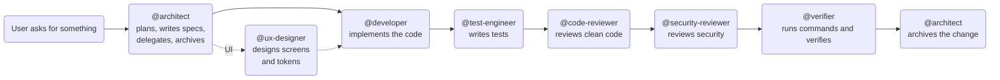

# OpenCode OpenSpec Multi-Agent

A multi-agent orchestrated development workflow built on [OpenSpec](https://openspec.dev).
Every change starts from a written specification, is implemented by a dedicated agent,
and passes independent code, security, and verification review before being archived.
No code is written until the spec is approved.
   

## Features

- Spec-first: every change is grounded in an OpenSpec spec (proposal, design, tasks)
- Structured loop: architect → developer → reviewers → verifier → archive
- Agents: architect, developer, code-reviewer, security-reviewer, verifier,
  test-engineer, ux-designer, repo-scout, diff-summarizer
- Setup wizard: `npx openspec-multiagent init` or `node scripts/setup.mjs`
- Preflight checks for Node, OpenSpec CLI, Context7, and MCP servers

## What the agents do

| Agent | Responsibilities | Access allowed | Access denied | Mode |
|-------|-----------------|----------------|---------------|------|
| **@architect** | Plans changes, writes OpenSpec specs, delegates work, approves reviews, archives changes; never writes source code. Drives the spec-driven loop. | Edit `openspec/**`, `AGENTS.md`, `opencode/agents/*`; read-only shell commands (`ls`, `cat`, `git status/diff/log/show`, `npm test`, `openspec validate`, `echo`); subagent, skill, read, glob, grep, webfetch, websearch on `*` | Edit `*` (denied: no source code edits outside OpenSpec/spec/agent files) | Primary (assisted or automatic execution mode) |
| **@developer** | Implements OpenSpec changes following repo conventions; YAGNI; clean code; adds high-ROI tests; validates before reporting. | Edit `*`; shell `*`; subagent `repo-scout`, `diff-summarizer`; skill, read, glob, grep on `*` | None explicit (edit and shell on `*` are allowed) | Subagent |
| **@code-reviewer** | Reviews code against clean-code criteria (12 rules) and tests; approves or requests changes; never closes specs. | Git read-only (`status`, `diff`, `log`, `show`); `echo`, `ls`, `pwd`, `cat`; `openspec show/list`; test commands (`npm test`, `pytest`, `cargo test`, etc.); subagent `repo-scout`, `diff-summarizer`; skill, read, glob, grep on `*` | Edit `*`; shell `*` (denied except read-only commands listed) | Subagent |
| **@security-reviewer** | Evaluates code against 12 security criteria; tags findings CRITICAL/WARNING/SUGGESTION; never modifies code. | Git read-only; `echo`, `ls`, `pwd`, `cat`, `head`, `tail`, `wc`; `grep -rn *`; `openspec show/list`; subagent `repo-scout`; skill, read, glob, grep on `*` | Edit `*`; shell `*` (denied except read-only commands listed) | Subagent |
| **@verifier** | Independently verifies implemented changes by running real project commands; maps spec scenarios to PASS/FAIL/UNVERIFIABLE; never writes code. | Read-only shell: `echo`, `ls`, `pwd`, `cat`, `head`, `tail`, `wc`; git read-only; `openspec show/list/validate`; test commands (`npm test`, `pytest`, `go test`, etc.); build/lint/typecheck commands (`npm run build`, `tsc`, `eslint`, etc.); subagent `repo-scout`; skill, read, glob, grep on `*` | Edit `*`; shell `*` (denied except read-only commands listed; no mutations, deploys, or installs) | Subagent |
| **@test-engineer** | Writes unit and integration tests from OpenSpec scenarios; generates mocks and fixtures; follows repo test conventions. | Edit `*`; `echo`, `cat`, `ls`, `pwd`; `openspec show/list`; subagent `repo-scout`, `diff-summarizer`; skill, read, glob, grep on `*` | Shell `*` (denied except read-only commands listed) | Subagent |
| **@ux-designer** | Reviews UI/UX requirements; generates ASCII wireframes; specifies design tokens; component specs; accessibility checks. Never modifies code. | `echo`, `cat`, `ls`, `pwd`; `openspec show/list`; subagent `repo-scout`, `diff-summarizer`; skill, read, glob, grep on `*` | Edit `*`; shell `*` (denied except read-only commands listed) | Subagent |
| **@repo-scout** | Scans repository stack, conventions, and commands; read-only report; no files written. | `ls`; `git rev-parse`, `git ls-files`; `rg`; `cat`; read, glob, grep on `*` | Edit `*`; shell `*` (denied except read-only commands listed) | Subagent |
| **@diff-summarizer** | Produces terse, high-signal summary of git diffs; flags risk hotspots; no fixes, no style review. | Git read-only (`status`, `diff`, `log`); read, glob, grep on `*` | Edit `*`; shell `*` (denied except read-only git commands listed) | Subagent |

Modes: **primary** = drives the change loop and may run read-only verification commands; **subagent** = dispatched by @architect with full context, independent session with no prior conversation history.



## Requirements

| Component | Minimum version | Why |
|---|---|---|
| Node.js | `>= 20.19.0` | Runs the setup scripts and OpenSpec CLI |
| `@fission-ai/openspec` | `>= 1.14.0` | Provides the `openspec-*` skills the agents load |
| `openspec-mcp` | any | MCP server exposing OpenSpec operations |
| Context7 | any | Up-to-date library/framework docs |
| OpenCode | V2 | Agent definitions and config use V2 shape |

> **Note:** Engram (project memory) and CodeGraph (code symbol graph) are optional components. They are not required for the OpenSpec multi-agent workflow to function.

## Quick start

Install and configure the workflow in your project:

```bash
npx openspec-multiagent init
```

Or from a clone:

```bash
git clone https://github.com/aortizsm/openspec-multiagent.git
cd openspec-multiagent
node scripts/setup.mjs
```

Then open OpenCode in your project and describe the change you want to make to `@architect`.

## Memory (Engram)

Engram is the project's persistent memory. It stores agreed decisions, flow rules, and change context so work can resume across sessions without repeating announcements or losing state.

- `mem_context` — recover current intent and open threads at session start
- `mem_save` — record decisions, rules, and checkpoint state
- `mem_search` — find past decisions before re-asking

Flow rules saved in Engram prevent announcement loops: execute first, announce later; one subagent at a time; stop and ask if repeating an action without executing it.

**Original project:** [Gentleman-Programming/engram](https://github.com/Gentleman-Programming/engram)

## npm scripts

| Script | What it does |
|---|---|
| `npm run setup` | Install/verify Node, OpenSpec CLI, Context7, and agents |
| `npm run check` | Preflight check (Node, OpenSpec, Context7, MCP servers) |
| `npm run test` | Run the project test suite |
| `npm run install-agents` | Copy agent definitions without touching OpenSpec |
| `npm run install-context7` | Configure only Context7 |
| `npm run install-engram` | Install/configure Engram local memory |
| `npm run reinstall` | Reinstall agents + MCP servers (overwrites existing) |
| `npm run reset` | Remove all multi-agent setup (destructive, requires `--confirm`) |

## License

MIT
