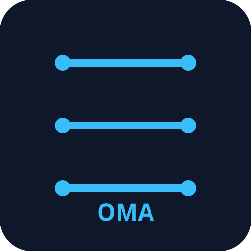
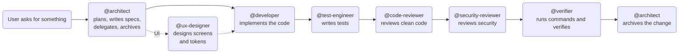

# OpenCode OpenSpec Multi-Agent

A multi-agent orchestrated development workflow built on [OpenSpec](https://openspec.dev).
Every change starts from a written specification, is implemented by a dedicated agent,
and passes independent code, security, and verification review before being archived.
No code is written until the spec is approved.

<div align="center">

</div>


## Features

- Spec-first: every change is grounded in an OpenSpec spec (proposal, design, tasks)
- Structured loop: architect → developer → reviewers → verifier → archive
- Agents: architect, developer, code-reviewer, security-reviewer, verifier,
  test-engineer, ux-designer, repo-scout, diff-summarizer
- Setup wizard: `npx openspec-multiagent init` or `node scripts/setup.mjs`
- Preflight checks for Node, OpenSpec CLI, Context7, and MCP servers

## What the agents do

**@architect**: plans the change, writes specs, delegates, approves and archives
**@developer**: implements the feature following repo conventions
**@test-engineer**: writes unit and integration tests from spec scenarios
**@code-reviewer**: reviews code against clean-code criteria and tests
**@security-reviewer**: reviews code against security criteria
**@verifier**: runs real commands and maps spec scenarios to pass/fail
**@ux-designer**: generates wireframes and design tokens for UI changes
**@repo-scout**: scans stack, conventions, and commands
**@diff-summarizer**: terse diff summary with risk hotspots



## Requirements

| Component | Minimum version | Why |
|---|---|---|
| Node.js | `>= 20.19.0` | Runs the setup scripts and OpenSpec CLI |
| `@fission-ai/openspec` | `>= 1.14.0` | Provides the `openspec-*` skills the agents load |
| `openspec-mcp` | any | MCP server exposing OpenSpec operations |
| Context7 | any | Up-to-date library/framework docs |
| OpenCode | V2 | Agent definitions and config use V2 shape |

## Quick start

Install and configure the workflow in your project:

```bash
npx openspec-multiagent init
```

Or from a clone:

```bash
git clone https://github.com/aortizsm/openspec-multiagent.git
cd openspec-multiagent
node scripts/setup.mjs
```

Then open OpenCode in your project and describe the change you want to make to `@architect`.

## Memory (Engram)

Engram is the project's persistent memory. It stores agreed decisions, flow rules, and change context so work can resume across sessions without repeating announcements or losing state.

- `mem_context` — recover current intent and open threads at session start
- `mem_save` — record decisions, rules, and checkpoint state
- `mem_search` — find past decisions before re-asking

Flow rules saved in Engram prevent announcement loops: execute first, announce later; one subagent at a time; stop and ask if repeating an action without executing it.

**Original project:** [Gentleman-Programming/engram](https://github.com/Gentleman-Programming/engram)

## npm scripts

| Script | What it does |
|---|---|
| `npm run setup` | Install/verify Node, OpenSpec CLI, Context7, and agents |
| `npm run check` | Preflight check (Node, OpenSpec, Context7, MCP servers) |
| `npm run test` | Run the project test suite |
| `npm run install-agents` | Copy agent definitions without touching OpenSpec |
| `npm run install-context7` | Configure only Context7 |
| `npm run install-engram` | Install/configure Engram local memory |
| `npm run reinstall` | Reinstall agents + MCP servers (overwrites existing) |
| `npm run reset` | Remove all multi-agent setup (destructive, requires `--confirm`) |

## License

MIT
