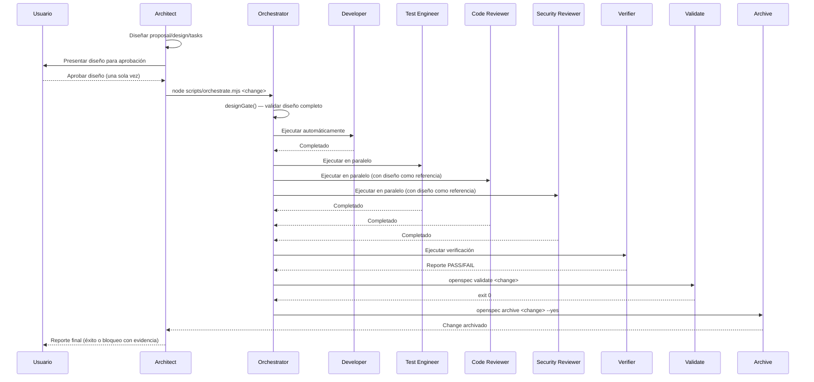

# Design: design-gate-auto-execution

## Executive Summary
Establecer un design gate que bloquee la ejecución del developer hasta que el diseño esté completo y aprobado por el usuario, y pasar a modo automático donde el architect ejecuta el loop completo sin aprobaciones intermedias del usuario.

## Current Flow (problema)
```
Usuario aprueba diseño → developer escribe código → code-reviewer encuentra problemas → developer corrige → security-reviewer encuentra problemas → developer corrige → verifier falla → developer corrige → vuelta al inicio
```
Problemas:
- El developer escribe código antes de que el diseño esté aprobado.
- Los revisores encuentran problemas después de escrito, generando vueltas.
- El usuario debe aprobar con `question` antes de delegar y antes de archivar.

## Target Flow (solución)
```
Architect diseña → Usuario aprueba diseño (una vez) → developer implementa → [test-engineer + code-reviewer + security-reviewer] verifican contra diseño → verifier → validate → archive (todo automático)
```

## Component 1: Design Gate

### Location
`scripts/orchestrate.mjs`, nueva función `designGate(changeName)` llamada al inicio de `main()` antes de ejecutar cualquier agente.

### Behavior
Validar que:
1. El directorio `openspec/changes/<changeName>/` existe.
2. Existen `proposal.md`, `design.md`, `tasks.md`.
3. Existe al menos un spec en `specs/*/spec.md` (salvo que `skip_specs: true`).
4. `design.md` contiene los 5 campos obligatorios: `status`, `executive_summary`, `artifacts`, `risks`, `next_recommended`.
5. `proposal.md` contiene sección `## Intent`, `## Why`, `## What Changes`.

Si falta algo, detener con mensaje claro indicando qué falta. No se ejecuta ningún agente.

### Rationale
Evita que el developer escriba código con un diseño incompleto. El usuario tiene una oportunidad clara de revisar y aprobar el diseño antes de que se escriba una sola línea de implementación.

## Component 2: Modo Automático (sin `question` intermedios)

### Location
`AGENTS.md` — sección "Explicación de solución antes de implementar" y "Orden del loop".

### Behavior
- Eliminar el requisito de que el architect use `question` para obtener aprobación antes de delegar al developer.
- Eliminar el requisito de que el architect use `question` para obtener aprobación antes de archivar.
- El architect ejecuta el loop completo automáticamente después de la única aprobación del usuario sobre el diseño.
- Si algo falla (revisor CRITICAL, verifier FAIL, validate error), el architect detiene y notifica al usuario con la evidencia, sin pedir aprobación para reintentar.

### Rationale
Elimina la fricción de aprobar en cada paso. El usuario solo aprueba el diseño una vez; el resto es ejecución técnica automatizada.

## Component 3: Revisores verifican conformidad al diseño aprobado

### Location
`AGENTS.md` — instrucciones para `code-reviewer` y `security-reviewer`.

### Behavior
- `code-reviewer` recibe `design.md` y `proposal.md` como referencia.
- Marca como CRITICAL solo lo que se desvíe del diseño aprobado o sea un bug claro.
- No marca como CRITICAL problemas de calidad que no estén en el diseño (esos son SUGGESTION o se documentan para cambios futuros).
- `security-reviewer` evalúa los 12 criterios de seguridad independientemente (estos son no negociables).

### Rationale
Reduce vueltas: los revisores no rechazan código por preferencias personales, solo por desviaciones del diseño aprobado o problemas de seguridad.

## Sequence Diagram (Mermaid)



## Risks & Mitigations

| Risk | Mitigation |
|------|-----------|
| Diseño aprobado es incompleto o incorrecto | El usuario revisa el diseño antes de aprobar; design gate valida estructura mínima obligatoria |
| Revisores siguen encontrando problemas nuevos | Documentar en AGENTS.md que se enfocan en conformidad al diseño aprobado; problemas nuevos son SUGGESTION |
| Modo automático saltea revisión humana importante | validate, verifier y security-reviewer siguen corriendo; solo se eliminan `question` intermedios |
| Cambios archivados sin commitear | El orquestrador ejecuta `git add` + `git commit` automáticamente al archivar (cambio separado pendiente) |

## Rollback
- Revertir `scripts/orchestrate.mjs` y `AGENTS.md` a versiones previas si el modo automático causa problemas operativos.
