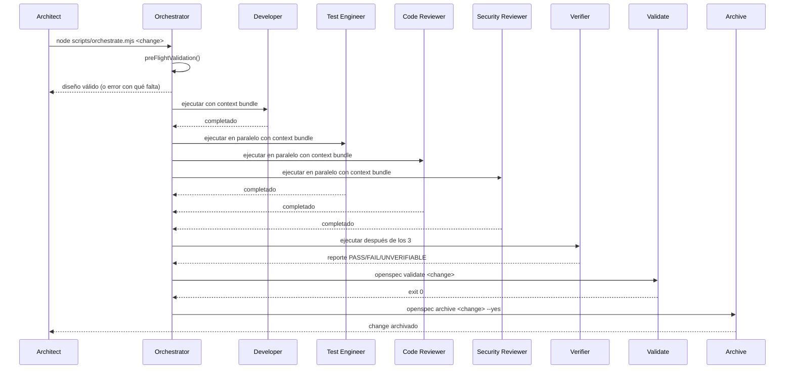

# Design: loop-performance

## Executive Summary
Acelerar el loop multiagente ejecutando `test-engineer`, `code-reviewer` y `security-reviewer` en paralelo después de `developer`, agregando validación previa al diseño, límite de reintentos por agente e inyección automática de contexto.

## Current Flow
```
developer → test-engineer → [code-reviewer + security-reviewer] → verifier → validate → archive
```

## Target Flow
```
developer → [test-engineer + code-reviewer + security-reviewer] → verifier → validate → archive
```

## Component 1: Parallel Execution of 3 Agents

### Location
`scripts/orchestrate.mjs`, función `runAgents`.

### Change
- `isReviewerGroupStart` detecta ahora un grupo de 3 agentes: `test-engineer`, `code-reviewer`, `security-reviewer` consecutivos después de `developer`.
- `runParallelReviewers` se renombra a `runParallelGroup` y ejecuta 3 agentes con `Promise.all` en lugar de 2.
- `verifier` sigue ejecutándose después de que los 3 completen.

### Code Sketch
```javascript
function isParallelGroupStart(agentsToRun, index) {
  return (
    agentsToRun[index] === 'test-engineer' &&
    agentsToRun[index + 1] === 'code-reviewer' &&
    agentsToRun[index + 2] === 'security-reviewer'
  );
}

async function runParallelGroup(agentsToRun, index, changeName) {
  saveCheckpoint(agentsToRun[index]);
  saveCheckpoint(agentsToRun[index + 1]);
  saveCheckpoint(agentsToRun[index + 2]);
  try {
    await Promise.all([
      runAgentAsync(agentsToRun[index], changeName),
      runAgentAsync(agentsToRun[index + 1], changeName),
      runAgentAsync(agentsToRun[index + 2], changeName),
    ]);
  } catch (error) {
    rollbackToCheckpoint();
    process.exit(1);
  }
}
```

## Component 2: Pre-flight Validation

### Location
`scripts/orchestrate.mjs`, nueva función `preFlightValidation(changeName)`.

### Change
Antes de ejecutar cualquier agente, validar:
1. El directorio `openspec/changes/<changeName>/` existe.
2. Existen `proposal.md`, `design.md`, `tasks.md`.
3. Existe al menos un spec en `openspec/changes/<changeName>/specs/*/spec.md`.
4. El diseño (`design.md`) contiene los 5 campos obligatorios: `status`, `executive_summary`, `artifacts`, `risks`, `next_recommended`.

Si falla cualquiera, se detiene con un mensaje claro y no se delega al `developer`.

### Rationale
Evita perder tiempo ejecutando agentes cuando el diseño está incompleto. El `architect` recibe un mensaje específico de qué falta antes de que se escriba código.

## Component 3: Circuit Breaker

### Location
`scripts/orchestrate.mjs`, modificación de `runAgent` y `runAgentAsync`.

### Change
- Cada agente tiene un contador de reintentos (máximo 3).
- Si un agente falla 3 veces, se detiene el orquestrador con un mensaje de escalada al `architect`.
- El contador se resetea por cambio nuevo.
- `--from <agent>` reanuda pero conserva el contador de fallos previos del mismo cambio.

### Rationale
Evita reintentos infinitos que consumen tiempo y tokens sin progreso.

## Component 4: Context Bundle Injection

### Location
`scripts/orchestrate.mjs`, nueva función `injectContextBundle(changeName, agent)` que se llama antes de ejecutar cada agente.

### Change
Antes de lanzar `npx opencode run -a <agent> -- <changeName>`, el orquestrador lee y adjunta al comando (o al entorno) los siguientes archivos del change:
- `proposal.md`
- `design.md`
- `tasks.md`
- `specs/*/spec.md` (todos los specs del change)
- `git diff` del change (si hay cambios sin commitear)

Esto elimina la necesidad de que el `architect` pase manualmente el contexto a cada agente.

### Alternative Considered
Usar `scripts/context-bundle.mjs` existente como entrada para cada agente. Decisión: integrar la lectura directa en `orchestrate.mjs` para evitar depender de un script separado que pueda no estar actualizado.

## Sequence Diagram (Mermaid)



## Risks & Mitigations

| Risk | Mitigation |
|------|-----------|
| `test-engineer` y `code-reviewer` escriben en los mismos archivos | `test-engineer` solo crea/escribe archivos de test (`.test.*`). `code-reviewer` es de solo lectura. |
| `verifier` ejecuta antes de que `test-engineer` termine sus tests | `verifier` depende de `Promise.all` de los 3; no se lanza hasta que todos terminen. |
| Circuit breaker detiene un cambio legítimo por fallos transitorios | Máximo 3 reintentos es suficiente para fallos transitorios; después se escala al `architect` para decisión humana. |
| Context bundle incompleto o desactualizado | Se lee directamente de disco justo antes de ejecutar cada agente; siempre refleja el estado actual del change. |

## Rollback
- Revertir `scripts/orchestrate.mjs` al commit anterior si el paralelismo causa regresiones.
- `AGENTS.md` se restaura si el nuevo orden del loop causa confusión operativa.
